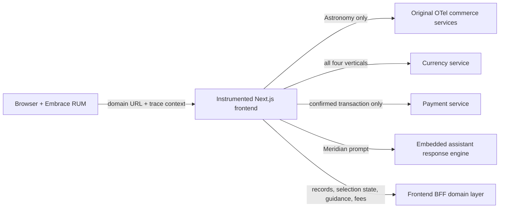

# Industry experiences and trace contracts

The frontend presents six runtime-selectable experiences: the original OpenTelemetry Astronomy Shop, Banking, Healthcare, Travel, Insurance, and Meridian. Astronomy is the unchanged default at `/`. The other customer-facing entry points are `/accounts`, `/patient`, `/flights`, `/policies`, and `/chat`.

This feature is intentionally frontend-only. It does not change the implementation, telemetry, databases, names, or behavior of any existing OTel Demo backend microservice. The alternate experiences use the instrumented Next.js frontend as a backend-for-frontend (BFF), and call an existing downstream service only where that service is semantically valid.

## Run and switch

From the repository root:

```shell
docker compose up --build
```

Open <http://localhost:8080/>. Use **Settings** to preview and apply an experience without rebuilding. A direct customer-facing URL always wins over a stored selection. Opening `/` always returns to Astronomy.

The browser session ID remains stable while switching. Alternate transaction experiences scope their temporary selection ID as `<session ID>:<industry>` so a Banking draft cannot appear in Healthcare, Travel, or Insurance. Meridian has no selection or currency provider requests at all.

## Architecture



The frontend domain layer provides deterministic fictional records, selection state, guidance, fee rules, and the confirmation receipt. These are not presented as calls to services that do not exist. A request still crosses from `frontend-web` to the instrumented `frontend` server and produces a real distributed trace. Currency conversion and payment use the existing services and preserve trace context.

Meridian always uses the embedded prompt-specific response engine. It deliberately does not call the stock shopping Agent/MCP path, because that path can introduce Product Catalog spans into an AI chat trace.

## Non-negotiable trace rules

- Astronomy retains the stock Product Catalog, Cart, Shipping, Checkout, Payment, Email, Currency, Recommendation, and Ad behavior.
- Banking, Healthcare, Travel, and Insurance never call Product Catalog, Cart, Shipping, Checkout, Recommendation, or Ad.
- Alternate records, related records, guidance, fees, and draft state are frontend BFF operations with domain-specific span names.
- Currency is allowed for displayed amounts and fees.
- Payment is allowed only for a submitted bill, statement, booking, or coverage confirmation.
- The stock Email endpoint is not used by alternate modes because it emits ecommerce `demo.order.*` telemetry. Confirmation is returned by the frontend BFF after Payment succeeds.
- Guided actions make a real browser-to-frontend request. If no matching downstream service exists, the trace stops at the frontend instead of inventing a dependency.
- Meridian calls only `/api/chat/respond`; it never starts global selection, currency, catalog, payment, or confirmation traffic.

## Page-by-page trace contracts

### Astronomy Shop

| Page or action | Browser request | Expected services | Notes |
| --- | --- | --- | --- |
| Home | `/api/products`, `/api/cart`, `/api/currency` | frontend, product-catalog, PostgreSQL, cart, Valkey, currency | Original behavior is unchanged. |
| Product detail | `/api/products/:id`, `/api/data`, `/api/recommendations` | frontend, product-catalog, PostgreSQL, ad, recommendation | Original product and recommendation flow. |
| Add to cart | `POST /api/cart` | frontend, cart, Valkey | Original cart mutation. |
| Cart and shipping | `/api/cart`, `/api/shipping` | frontend, cart, product-catalog, shipping, quote, currency | Original review flow. |
| Place order | `POST /api/checkout` | frontend, checkout, cart, product-catalog, currency, shipping, payment, email | Original full checkout fan-out. |

### Banking (`/accounts`)

| Page or action | Browser request | Expected trace | Must not appear |
| --- | --- | --- | --- |
| Account home and bills | `/api/accounts/bills`, `/api/accounts/payment-selection`, `/api/accounts/currencies` | `frontend` → `banking.records.records_list` → `currency`; selection-state read in `frontend`; currency list | product-catalog, cart, shipping, checkout |
| Bill detail | `/api/accounts/bills/:id`, `/api/accounts/related-bills`, `/api/accounts/guidance` | frontend record/guidance spans and currency | product-catalog, recommendation, ad |
| Select a bill | `POST /api/accounts/payment-selection` | `frontend` → `banking.workflow_state.selection_save` | cart, Valkey |
| Payment review | `/api/accounts/payment-selection`, `/api/accounts/payment-fees` | frontend selection read; `banking.fee_quote.fee_calculation` → currency | shipping, quote, checkout |
| Authorize payment | `POST /api/accounts/payments` | `frontend` → `banking.transaction.transaction_execute` → currency → payment | checkout, cart, shipping, product-catalog, email |
| Move money, card controls, deposit, support | `POST /api/accounts/service-requests` | frontend guided-action span | fabricated commerce services |

### Healthcare (`/patient`)

| Page or action | Browser request | Expected trace | Must not appear |
| --- | --- | --- | --- |
| Patient home and statements | `/api/patient/statements`, `/api/patient/payment-selection`, `/api/patient/currencies` | `frontend` → `healthcare.records.records_list` → currency; selection-state read | product-catalog, cart, shipping, checkout |
| Statement detail | `/api/patient/statements/:id`, `/api/patient/related-statements`, `/api/patient/resources` | frontend record/resource spans and currency | product-catalog, recommendation, ad |
| Select a statement | `POST /api/patient/payment-selection` | `frontend` → `healthcare.workflow_state.selection_save` | cart, Valkey |
| Payment review | `/api/patient/payment-selection`, `/api/patient/service-fees` | frontend selection read; fee calculation → currency | shipping, quote, checkout |
| Submit payment | `POST /api/patient/payments` | frontend transaction → currency → payment | checkout, cart, shipping, product-catalog, email |
| Appointment, care message, records, support | `POST /api/patient/requests` | frontend guided-action span | fabricated clinical services |

### Travel (`/flights`)

| Page or action | Browser request | Expected trace | Must not appear |
| --- | --- | --- | --- |
| Flight home/search | `/api/flights/search`, `/api/flights/trip-selection`, `/api/flights/currencies` | `frontend` → `travel.records.records_list` → currency; selection-state read | product-catalog, cart, shipping, checkout |
| Flight detail | `/api/flights/search/:id`, `/api/flights/alternatives`, `/api/flights/offers` | frontend record/offer spans and currency | product-catalog, recommendation, ad |
| Select flight | `POST /api/flights/trip-selection` | `frontend` → `travel.workflow_state.selection_save` | cart, Valkey |
| Trip review | `/api/flights/trip-selection`, `/api/flights/booking-fees` | frontend selection read; booking fee → currency | shipping, quote, checkout |
| Confirm trip | `POST /api/flights/bookings` | frontend transaction → currency → payment | checkout, cart, shipping, product-catalog, email |
| Stays, cars, trip support | `POST /api/flights/service-requests` | frontend guided-action span | fabricated inventory services |

Travel dates are calculated relative to the viewer's current local date on every fresh page load. The Stays and Cars guided flows use the same relative date window.

### Insurance (`/policies`)

| Page or action | Browser request | Expected trace | Must not appear |
| --- | --- | --- | --- |
| Policy home and coverage | `/api/policies/coverage`, `/api/policies/coverage-selection`, `/api/policies/currencies` | `frontend` → `insurance.records.records_list` → currency; selection-state read | product-catalog, cart, shipping, checkout |
| Coverage detail | `/api/policies/coverage/:id`, `/api/policies/related-coverage`, `/api/policies/guidance` | frontend record/guidance spans and currency | product-catalog, recommendation, ad |
| Select coverage | `POST /api/policies/coverage-selection` | `frontend` → `insurance.workflow_state.selection_save` | cart, Valkey |
| Coverage review | `/api/policies/coverage-selection`, `/api/policies/service-fees` | frontend selection read; policy fee → currency | shipping, quote, checkout |
| Confirm coverage | `POST /api/policies/confirmations` | frontend transaction → currency → payment | checkout, cart, shipping, product-catalog, email |
| Claim, documents, advisor, claims center | `POST /api/policies/service-requests` | frontend guided-action span | fabricated underwriting services |

### Meridian (`/chat`)

| Page or action | Browser request | Expected trace | Must not appear |
| --- | --- | --- | --- |
| Open or new chat | none | Embrace breadcrumb/span only | currency, cart, product-catalog |
| Send prompt or suggestion | `POST /api/chat/respond` | `frontend-web` → `frontend`; `app.ai.response_mode=embedded_backend` | agent, MCP, product-catalog, cart, shipping, checkout, payment |
| Copy response or load recent chat | none | Embrace breadcrumb/span only | all commerce services |

## Telemetry contract

The browser initializes the Embrace Web SDK while retaining the existing browser OpenTelemetry provider. Every request carries the active trace context plus bounded, allowlisted attributes:

- `app.experience.name`: `astronomy`, `banking`, `healthcare`, `travel`, `insurance`, or `ai`;
- `app.user_journey`: the active user journey;
- `app.workflow.step`: a neutral workflow step such as `records_load`, `selection_state_sync`, `review_load`, `fee_calculation`, or `transaction_submit`;
- `app.operation.name`: the domain-specific operation such as `bills_list_viewed` or `flight_booking_submitted`;
- `app.backend.domain`: the active domain;
- `app.backend.resource`: `records`, `selection`, `fee_quote`, `transaction`, `guidance`, `related_records`, `guided_action`, or `assistant_response`;
- `app.record.id`: a stable non-Astronomy record identifier;
- `app.transaction.id`: the alternate-mode confirmation identifier;
- `session.id`: the stable browser/Embrace correlation ID;
- `enduser.id`: the backend state identity, scoped by experience outside Astronomy.

The same vocabulary is used for Embrace breadcrumbs, logs, custom spans, and session properties. Prompt text, patient data, balances, email addresses, and form contents are never telemetry dimensions.

## Failure stories

- `paymentFailure` remains useful for Banking, Healthcare, Travel, and Insurance because they call the existing Payment service directly. A failed payment keeps the user on the review page and creates no success receipt.
- Astronomy retains its original cart, shipping, checkout, image-delay, and payment failure stories.
- Cart, Shipping, Product Catalog, Recommendation, and Ad failures are not alternate-industry stories because those services are intentionally outside their contracts.
- A guided-action request failure is shown as a failure; the UI never manufactures success.

## Validation

From `src/frontend` run:

```shell
npm run build
npx cypress run --spec cypress/e2e/IndustryExperience.cy.ts
```

The Cypress suite verifies semantic routes, industry/resource headers, scoped selection identities, real transaction responses, guided-action requests, failure behavior, Meridian isolation, and Astronomy as the root default.
